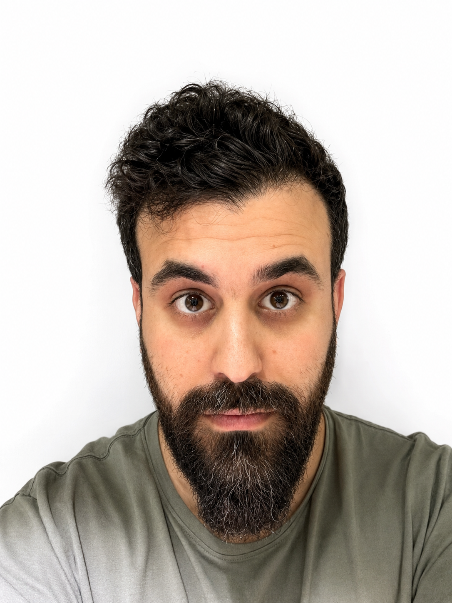

<main id="main">

<section class="hero hero-about" id="about">

<figure class="portrait">
<canvas id="portrait-resolution" aria-hidden="true"></canvas>

<figcaption>HOW MUCH DETAIL IS ENOUGH?</figcaption>
<label for="resolution">Resolution</label><input id="resolution" type="range" min="0" max="5" value="5" step="1" aria-valuetext="Original resolution"><output for="resolution" id="resolution-value">Original</output>

<label for="color-depth">Color</label><input id="color-depth" type="range" min="0" max="4" value="4" step="1" aria-valuetext="Full RGB color"><output for="color-depth" id="color-depth-value">RGB</output>
</figure>
<figure class="network-figure"><svg id="network" viewBox="0 0 520 350" role="img" aria-label="A neural network with a narrow hidden layer, illustrating a computational bottleneck"></svg><figcaption>A STUDY IN BOTTLENECKS<button id="signal" type="button">Send a signal ↗</button></figcaption>
Small interventions. System-wide effects.

<i></i> Representation<i class="key-bottleneck"></i> Bottleneck
</figure>

01 / ABOUT · COMPUTER VISION & DEEP LEARNING

Moshe Kimhi

<h1>Learning more. <em>With less.</em></h1>

Research Scientist, Google Research · PhD researcher, Technion

I study neural networks under real constraints: less compute, fewer labels, and more possibility.

I’m a Research Scientist at Google Research and a PhD student in Computer Science at the Technion, advised by <a href="https://insight.bgu.ac.il/">Chaim Baskin</a>, who leads the INSIGHT Lab at Ben-Gurion University of the Negev (BGU), and <a href="https://research.google/people/ehud-rivlin/">Ehud Rivlin</a>.

My research spans vision-language models, representation learning, semi-supervised learning, noisy labels, and robust AI systems. I hold BSc and MSc degrees in Electrical and Computer Engineering from the Technion. I review for ICCV, ICML, WACV, and TMLR, and co-teach <a href="https://vistalab-technion.github.io/cs236781/">Computer Vision & Deep Learning</a>.

Have an interesting problem in mind? <a href="mailto:moshekimhi91@gmail.com?subject=Coffee%20and%20interesting%20problems">Let’s schedule a coffee ↗</a>

<a href="mailto:moshekimhi91@gmail.com">Email ↗</a><a href="https://scholar.google.com/citations?user=uz7qJbsAAAAJ&hl=en">Scholar ↗</a><a href="https://github.com/mkimhi">GitHub ↗</a><a href="https://www.linkedin.com/in/moshekimhi/">LinkedIn ↗</a>

</section>

<label for="depth">Reading depth</label>A little context

<button type="button" data-depth-choice="0">Overview</button><input type="range" id="depth" min="0" max="2" step="1" value="1" aria-valuetext="Context: paper summaries"><button type="button" data-depth-choice="2">In depth</button>
<nav aria-label="Page sections"><a href="#about">01 About</a><a href="#perspective">02 Perspective</a><a href="#research">03 Publications</a><a href="#talks">04 Talks</a></nav>

<section id="perspective" class="section perspective">

02 / PERSPECTIVE
<h2>A modern <em>glassblower.</em></h2><svg class="vessel" viewBox="0 0 400 200" role="img" aria-label="An abstract glass vessel with a narrow neck expanding into a broad body"><g fill="none" stroke="currentColor" stroke-width="1"> <path d="M20 85H115C160 85 155 25 245 25C335 25 370 70 370 100S335 175 245 175C155 175 160 115 115 115H20"/>
<path d="M20 90H115C170 90 175 45 245 45S350 80 350 100S315 155 245 155S170 110 115 110H20"/><path d="M20 95H115C180 95 195 70 245 70S330 90 330 100S295 130 245 130S180 105 115 105H20"/><path d="M20 100H370"/></g></svg>

I see myself as a modern glassblower: finding the narrow neck, then reshaping it.

In neural networks, the bottleneck might be data, compute, memory, or the pipeline connecting them. I’m interested in identifying what limits a system, understanding why, and opening up room for it to do more.

I’m a strong believer in <a href="https://en.wikipedia.org/wiki/Jevons_paradox">Jevons paradox ↗</a>: greater efficiency can increase total demand. For me, making AI more efficient is a way to unlock new uses, broader access, and more ambitious questions.

That perspective connects my work on adaptive resolution, learning with imperfect data, quantization, and neural network robustness. The recurring question is simple: where does an intervention matter most?

</section>
<section id="research" class="section">

03 / PUBLICATIONS
<h2>Find the constraint. <em>Expand what’s possible.</em></h2>

From visual tokens to training labels, I look for the small changes that make a large difference.


</section>
<section id="talks" class="section talks">
04 / TALKS
<h2>Ideas, <em>in conversation.</em></h2>

</section>
</main>
